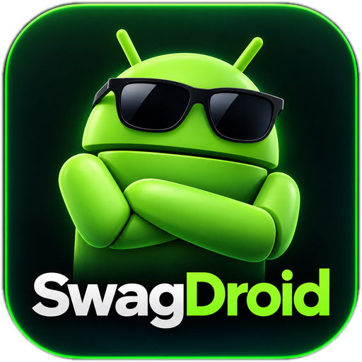

<p align="center">
  
</p>

<h1 align="center">SwagDroid v1.0.0 🛡️⚡</h1>

<p align="center">
  <b>Открытый швейцарский нож для Android-смартфонов (GPL-3.0)</b><br/>
  Диагностика и системные инструменты · Очистка с просмотром плана · Оптимизатор и Debloater · Проверка рисков приложений · DNS-фильтрация
</p>

---

## Текущий этап: стабилизация следующей версии

Проект проходит пересмотр безопасности и достоверности результатов. **Это ещё не проверенный выпуск следующей версии.**

- [Подробный разбор исходной версии](docs/PROJECT_AUDIT_2026-10-26.md).
- [Первый этап: ограничения опасных действий, изменения и проверки](docs/STABILIZATION_STEP_1.md).
- [Второй этап: проверяемые команды, журнал шагов и восстановление](docs/STABILIZATION_STEP_2.md).
- В очистке медиа, остатки приложений и дубликаты не выбраны автоматически. Перед удалением требуется просмотр общего списка и подтверждение необратимости. **Корзины и отката файлов пока нет.**
- Массовое удаление «пакетов-призраков», отмена установочных сессий и выключение служб доступности отключены; доступны проверки без автоматического изменения.
- Глобальная очистка кэшей в Cleaner временно недоступна: она не соблюдает исключения отдельных приложений.
- В StateVault добавлены строгие чтения, журнал шагов, проверка результата и защита от конфликтов. Неопределённое завершение команды блокирует новые мутации до подтверждённой загрузки нового ядра. Старые точки остаются для просмотра/экспорта, но не исполняются автоматически.
- Произвольные shell-«откаты» временно отключены. Новое ядро проверено отдельно на JVM; штатная Android-сборка и миграция на устройстве ещё не подтверждены. Системные изменения не являются атомарной OS-транзакцией.

## Реализованные инструменты и ограничения

1. **Права:** обычный режим, подключение уже работающего Shizuku/Sui, Root с обнаружением/запросом через libsu и отдельными `su`-процессами для команд. Возможности зависят от Android, OEM и выданных разрешений. Shizuku не повышает автоматически права файлового API приложения.
2. **StateVault:** Room-журнал Settings/AppOps/состояний пакетов с записью каждого шага и проверкой прямого/обратного состояния. Старые и повреждённые записи не исполняются вслепую. Статические и runtime-ограничения пакетов не гарантируют защиту от любых OEM-зависимостей или повреждений системы.
3. **Пульс:** паспорт устройства, расчётные показатели и подключение прав. Часть показаний, включая ресурс батареи, — оценки, не аппаратная диагностика.
4. **Fixer:** каталог 53 сценариев по 12 подсистемам. Некоторые теперь доступны только для ручной проверки; наличие настройки само по себе не доказывает неисправность.
5. **Optimizer:** пресеты, системные настройки, Game Mode, ART и управление пакетами. В UAD-каталоге 4 123 записи, из них 61 помечена как русскоязычная. Совместимость и безопасность отключения конкретного пакета зависят от устройства.
6. **Cleaner:** поиск доступных файлов, SHA-256-дубликатов и похожих изображений; конечный план, подтверждение и повторная проверка перед удалением. Фильтры известных важных путей не заменяют резервную копию.
7. **Проверка рисков:** package-ID, строки внутри APK, разрешения и маркеры tracker SDK. Небольшой каталог тестовых хешей и эвристики **не являются полноценным антивирусом** и не доказывают отсутствие угроз.
8. **AdBlock:** локальный DNS VPN, внешний Private DNS и root-hosts. Это разные механизмы с разным покрытием; они не фильтруют любой трафик и не гарантируют отсутствие обходов.

Документы `STAGE2`–`STAGE5` ниже сохранены как история разработки, а не как подтверждение текущих гарантий безопасности.

---

## 🏗️ Структура 11 модулей проекта

```text
SwagDroid/
├── app/                   # Оболочка v1.0.0, адаптивные иконки SwagDroid, R8-правила, офлайн Crash Black-Box
├── core/
│   ├── model/             # Доменные модели привилегий, паспорта железа и полиморфных операций StateVault
│   ├── designsystem/      # Тема Material 3 (OLED Dark / Light), векторные иконки, фирменная эмблема
│   ├── privilege/         # Движок команд (Local / Shizuku UID 2000 / Sui & libsu UID 0) с таймаутами (см. ограничения аудита)
│   └── vault/             # Журнал Room + Mutex и статический список защищённых пакетов
├── feature/
│   ├── dashboard/         # Экран «Пульс», мастер Беспроводного ADB, Root-советник и экспорт StateVault JSON
│   ├── fixer/             # Доктор системы: 53 сценария, включая проверки без авто-ремонта по 12 подсистемам + Реаниматор пушей
│   ├── optimizer/         # Оптимизатор PRO v2: 7 пресетов + JSON, 24 твика, Тюнер UI, Game Mode и 4 123 UAD-ng
│   ├── cleaner/           # Умная очистка с Бронёй паролей/аккаунтов, защитой от симлинков и Дедупликатором
│   ├── adblock/           # 3-режимный AdBlock (Dual-Stack IPv4/IPv6 DNS VPN / DoT без слота VPN / Root hosts)
│   └── security/          # Эвристики рисков, карантин и поиск маркеров tracker SDK
├── scripts/
│   └── build-release.sh   # Единый скрипт запуска всех JUnit-тестов и сборки Debug + Release APK
└── docs/
    ├── RESEARCH_AND_PLAN.md                       # Инженерный ресерч и дорожная карта проекта
    ├── STAGE2_FIXER_AND_OPTIMIZER_CATALOG.md      # Каталог 12 подсистем Фиксера и базы Оптимизатора
    ├── STAGE3_CLEANER_AND_OPTIMIZER_PRO.md        # Архитектура Брони паролей и Оптимизатора PRO v2
    ├── STAGE4_SECURITY_ANTIVIRUS_AND_ADBLOCK.md   # Архитектура Антивируса/Анти-Майнера и AdBlock 3-в-1
    ├── STAGE5_RELEASE_AUDIT_AND_BUILD.md          # Исторический отчёт о сборке v1.0.0; ограничения см. PROJECT_AUDIT
    └── ci/github-actions-build.yml                # Workflow облачной сборки Debug + R8 Release APK
```

---

## 🚀 Полная сборка `SwagDroid v1.0.0`

### Вариант 1 — Скриптом в 1 команду (JDK 21 + Android SDK 37)
```bash
./scripts/build-release.sh
```
Скрипт последовательно запускает модульные тесты всех 11 модулей (`testDebugUnitTest`), собирает отладочный `app-debug.apk` (`com.swagdroid.debug`) и сжатый R8 подписанный релизный **`app/build/outputs/apk/release/app-release.apk`** (`com.swagdroid` `v1.0.0`), для тестовой установки. Без настроенного `SWAG_KEYSTORE_PATH` release подписывается debug-ключом; это не production-подпись.

### Вариант 2 — Облачная сборка в GitHub Actions (без локального Android SDK)
Workflow уже находится в [`.github/workflows/build.yml`](.github/workflows/build.yml). Запустите **`SwagDroid v1.0.0 Full Build & Tests`** — готовые APK появятся во вкладке **Artifacts**.

---

## 📄 Лицензия
Проект распространяется под открытой лицензией **[GNU GPL v3.0](LICENSE)**.
